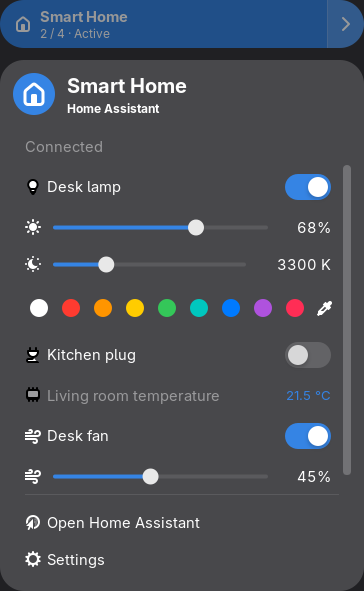
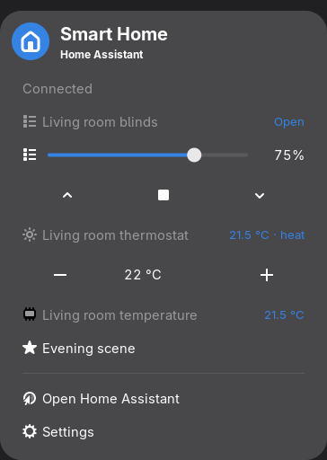
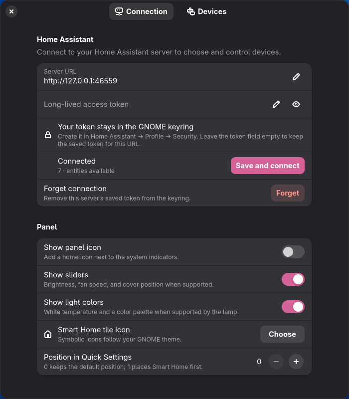
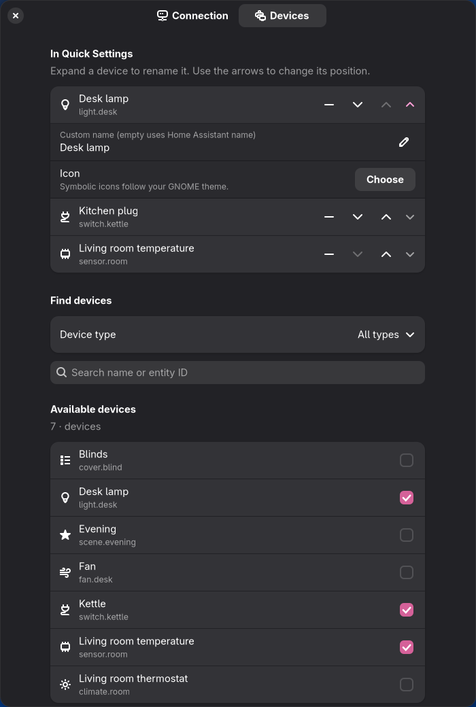
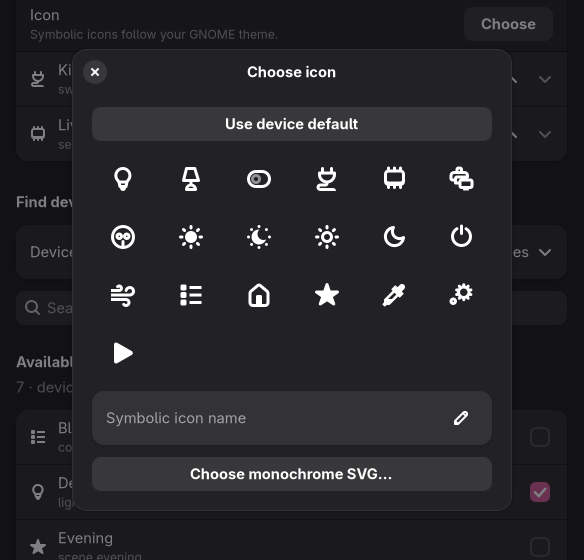

# Gnome Smart Home

Control your Home Assistant devices from the **Smart Home** tile in GNOME Quick Settings. Choose which entities appear, give them custom names or symbolic icons, and arrange them in the order you want. The extension uses GNOME Shell widgets and a GTK 4/libadwaita preferences window. The interface is available in English and Russian.

## Screenshots

Captured on GNOME Shell 50 with demo Home Assistant entities.

| Lights, switches, and fans | Covers, thermostats, and scenes |
| --- | --- |
|  |  |

<details>
<summary>Custom light color</summary>


</details>

<details>
<summary>Connection, panel, and device preferences</summary>

**Connection and panel settings**



**Favorites and device discovery**



**Symbolic icon chooser**



</details>

## Compatibility

The extension supports **GNOME Shell 50 on Wayland** and was tested on GNOME Shell 50.6. Home Assistant must be reachable from your desktop and expose the entities you want to control.

- **Runtime:** GJS, GTK 4, libadwaita, libsoup 3, libsecret and their GObject Introspection bindings, plus a Secret Service provider such as GNOME Keyring.
- **Build:** GNU Make, Bash, `gnome-extensions`, `glib-compile-schemas`, and gettext's `msgfmt`.
- **Development and tests:** Node.js for unit tests. The UI tests use `gnome-shell-test-tool` from GNOME 50, `dbus-run-session`, `gnome-keyring-daemon`, and `timeout`. The interactive preview also needs Mutter Devkit.

## Install

From a checkout of this repository, run:

```sh
make install
```

This builds the ZIP and installs it for the current user. On a first install, or after an update to JavaScript already loaded by GNOME Shell, log out of GNOME and back in to load the extension. Open its preferences with `make prefs` or from the **Smart Home → Settings** menu.

To build an installable ZIP for another machine, run `make build`. The archive is written to `dist/gnome-smart-home@local.shell-extension.zip`. You can install it with `gnome-extensions install <path-to-zip>` and enable `gnome-smart-home@local` in the Extensions app once GNOME has loaded it.

## Connect to Home Assistant

1. Open your Home Assistant profile and create a **Long-lived access token** under **Security**.
2. Open the extension's **Connection** tab. Enter the base URL of your server, such as `http://homeassistant.local:8123` or `https://ha.example.org`. Use the final URL when connecting through a reverse proxy.
3. Paste the token and select **Save and connect**. The extension checks the connection before saving it.
4. Open **Devices** and select the entities to display. Use the arrows to reorder them. Expand a favorite to rename it or choose a different icon.

The **Panel** settings let you change the tile position and icon, enable the optional top-bar icon, and show or hide sliders and color controls. Position `0` uses GNOME's default placement. Position `1` puts the tile first.

Tokens are stored in your keyring. The extension uses GSettings for the server URL, favorites, and appearance preferences. **Forget connection** clears the current server's credentials and favorites. Switching server URLs clears favorites so device identifiers from one server do not carry over to another. For HTTPS, the system must trust the server's certificate.

## Supported controls

Available controls depend on the capabilities and permissions exposed by Home Assistant.

| Entity | Controls |
| --- | --- |
| Lights | On/off, brightness, white temperature, color presets, and a full color picker |
| Switches and input booleans | On/off |
| Fans | On/off and speed |
| Covers | Open, close, stop, and position |
| Thermostats | Current and target temperature with adjustment for a single setpoint |
| Scenes, scripts, and buttons | Activate, run, or press |
| Sensors and binary sensors | Read their current state |

The eyedropper beside the color presets opens the color editor for lamps that support color. A color or brightness selection can turn a light on. Thermostats that use a temperature range display their state. Adjust their range or HVAC mode in Home Assistant.

## Develop and test

Run `make` to list the available commands.

| Command | Purpose |
| --- | --- |
| `make dev` | Open an isolated GNOME Devkit window with seven demo entities |
| `make check` | Validate JavaScript, GSettings schemas, and translations, then run unit and API tests |
| `make test` | Run the model tests and the GJS client against a local Home Assistant fixture |
| `make test-ui` | Exercise Quick Settings, device controls, the color picker, and preferences in a headless GNOME session |
| `make test-preview` | Verify demo startup and preference synchronization in a headless GNOME session |
| `make clean` | Remove the generated ZIP, schema, and translation catalog |

The Devkit uses a temporary profile, keyring, and local server. Demo commands are logged to `tests/artifacts/devkit.log`. Use **Ctrl+C** in the launch terminal to stop it. Restart the preview to load code changes.

### Code layout

| Path | Responsibility |
| --- | --- |
| `extension.js` and `lib/controls.js` | Quick Settings integration, device widgets, and command feedback |
| `prefs.js` and `lib/preferences.js` | Server setup, entity discovery, and preferences |
| `lib/client.js` and `lib/model.js` | Home Assistant REST discovery, WebSocket subscriptions, state updates, and service payloads |
| `lib/credentials.js` | Server-scoped token storage via libsecret |
| `lib/color-picker*.js` | Native color chooser in a separate GTK process |
| `lib/icons.js` and `icons/` | Symbolic icon selection, import, and upstream assets |
| `schemas/`, `po/`, and `tests/` | GSettings schema, translations, and tests |

The preferences process verifies the server and lists entities via REST. The extension process subscribes to selected entities over WebSocket and sends Home Assistant service calls. A control shows the requested value immediately and reconciles it with the next server update. Opening the color chooser launches a GTK process that returns the selected RGB values to the extension.

For contributions, keep device commands and capability checks in the model where possible. Wrap new UI strings for translation, run `make check`, and use `make test-ui` for changes to Shell widgets or GTK preferences.

## License

The project code and documentation are licensed under the [MIT License](LICENSE). The bundled [GNOME Icon Development Kit](https://gitlab.gnome.org/Teams/Design/icon-development-kit) SVGs are [CC0 1.0](icons/gnome/COPYING.md). See the [icon credits](icons/README.md) for asset provenance.
