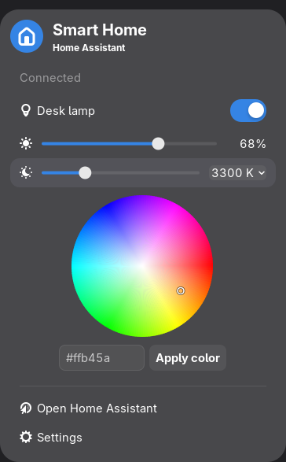

# Gnome Smart Home

Control your Home Assistant devices from the **Smart Home** tile in GNOME Quick Settings. Choose which entities appear, give them custom names or symbolic icons, and arrange them in the order you want.

## Screenshots

Captured on GNOME Shell 50 with demo Home Assistant entities.

| Lights, switches, and fans | Covers, thermostats, and scenes |
| --- | --- |
|  |  |

<details>
<summary>Custom light color</summary>



</details>

<details>
<summary>Connection, panel, and device preferences</summary>

**Connection and panel settings**


**Favorites and device discovery**


**Symbolic icon chooser**


</details>

## Compatibility

The extension supports **GNOME Shell 50 on Wayland**. Your desktop needs access to your Home Assistant server and a keyring such as GNOME Keyring to store the access token.

## Install

If you have the extension ZIP, run `gnome-extensions install <path-to-zip>`. Add `--force` when updating an existing installation.

Installing from this repository requires GNU Make, Bash, `gnome-extensions`, `glib-compile-schemas`, and gettext's `msgfmt`. Run the following command from the repository directory.

```sh
make install
```

After a manual install or update, log out and back in to load the extension. Enable **Gnome Smart Home** in the Extensions app if needed. Open its preferences from the Extensions app or from **Smart Home → Settings** in Quick Settings.

## Connect to Home Assistant

1. Open your Home Assistant profile and create a **Long-lived access token** under **Security**.
2. Open the extension's **Connection** tab. Enter the base URL of your server, such as `http://homeassistant.local:8123` or `https://ha.example.org`. Use the final URL when connecting through a reverse proxy.
3. Paste the token and select **Save and connect**. The extension checks the connection before saving it.
4. Open **Devices** and select the entities to display. Use the arrows to reorder them. Expand a favorite to rename it or choose a different icon.

The **Panel** settings let you change the tile position and icon, enable the optional top-bar icon, and show or hide sliders and color controls. Position `0` uses GNOME's default placement. Position `1` puts the tile first.

**Forget connection** removes the current server's token from your keyring and clears your favorites. Switching to another server also clears your favorites. For HTTPS, your system must trust the server's certificate.

## Supported controls

Available controls depend on the capabilities and permissions exposed by Home Assistant.

| Entity | Controls |
| --- | --- |
| Lights | On/off, brightness, white temperature, and an inline color wheel with hex input |
| Switches and input booleans | On/off |
| Fans | On/off and speed |
| Covers | Open, close, stop, and position |
| Thermostats | Current and target temperature with adjustment for a single setpoint |
| Scenes, scripts, and buttons | Activate, run, or press |
| Sensors and binary sensors | Read their current state |

For lamps that support color, select the arrow beside the white-temperature value to expand the color wheel. Click a color on the wheel, or enter a hex value and select **Apply color**. RGB-only lights show a **Light color** row. A color or brightness selection can turn a light on.

Thermostats that use a temperature range display their state. Adjust their range or HVAC mode in Home Assistant.

## License

The project code and documentation are licensed under the [MIT License](LICENSE). The bundled [GNOME Icon Development Kit](https://gitlab.gnome.org/Teams/Design/icon-development-kit) SVGs are [CC0 1.0](icons/gnome/COPYING.md). See the [icon credits](icons/README.md) for asset provenance.
